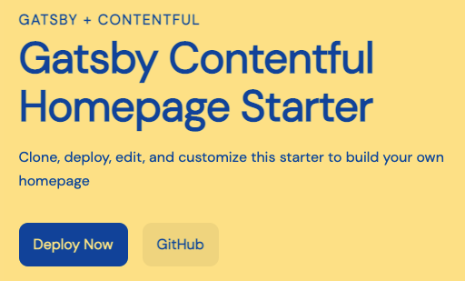
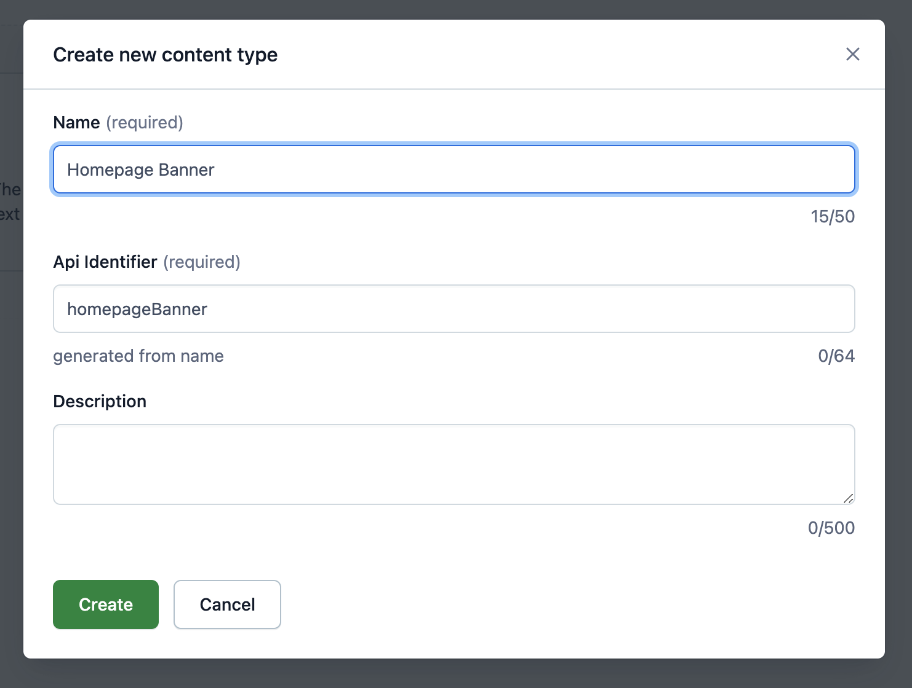
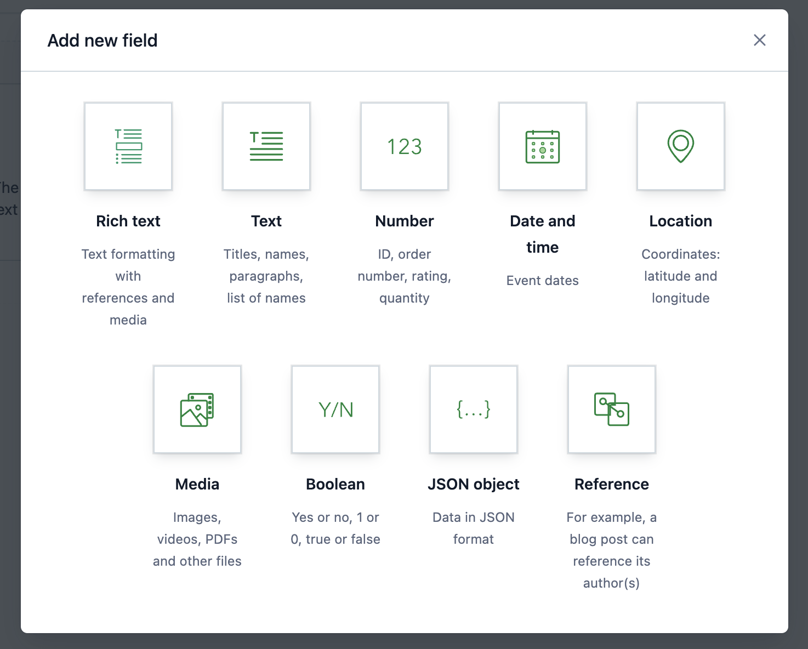
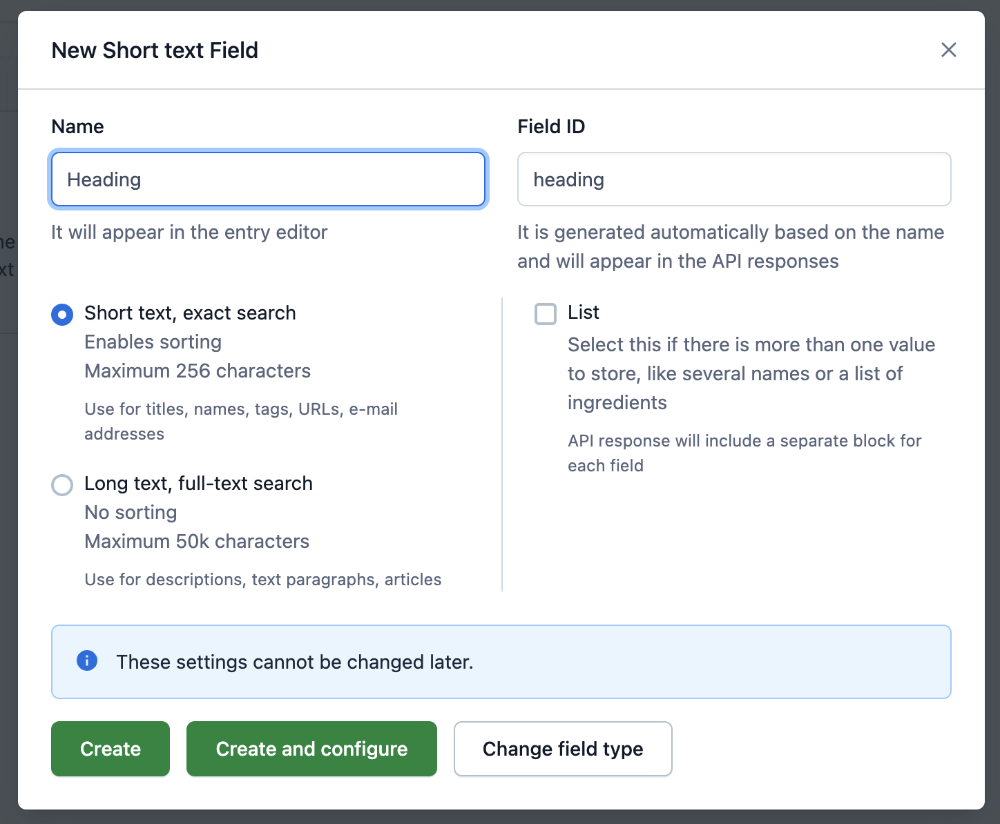
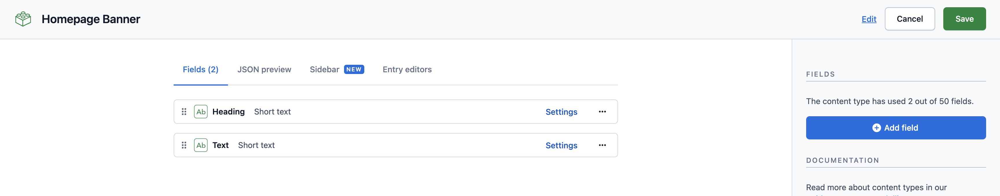
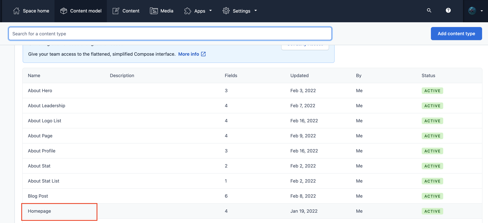
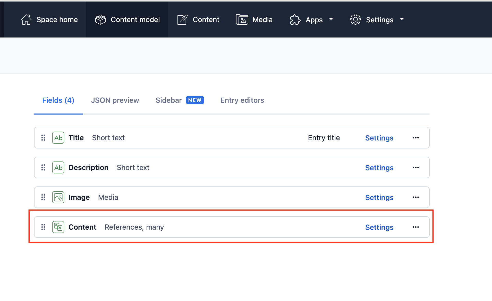
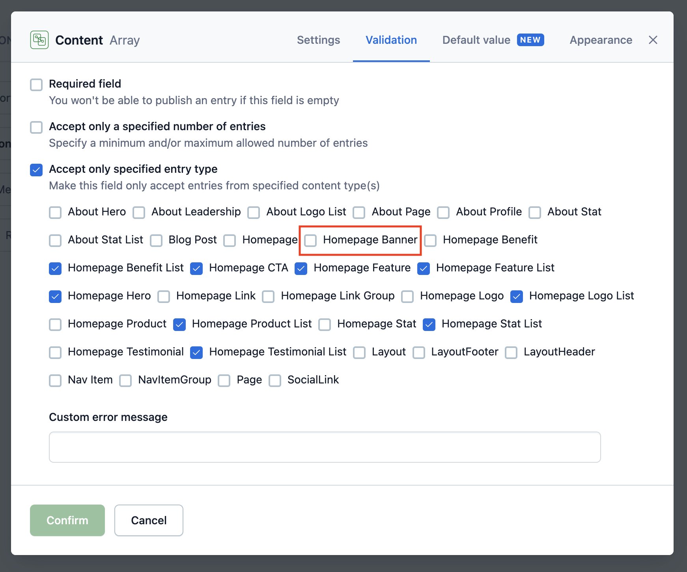
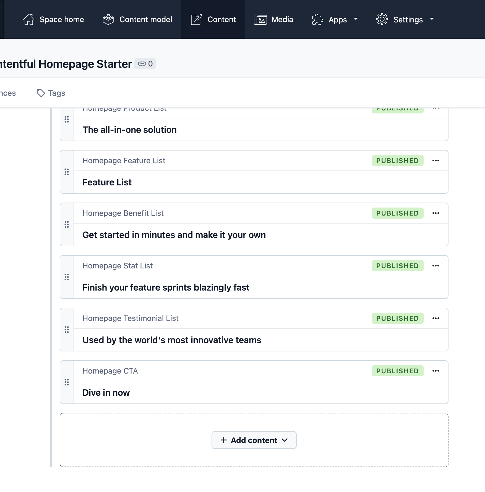
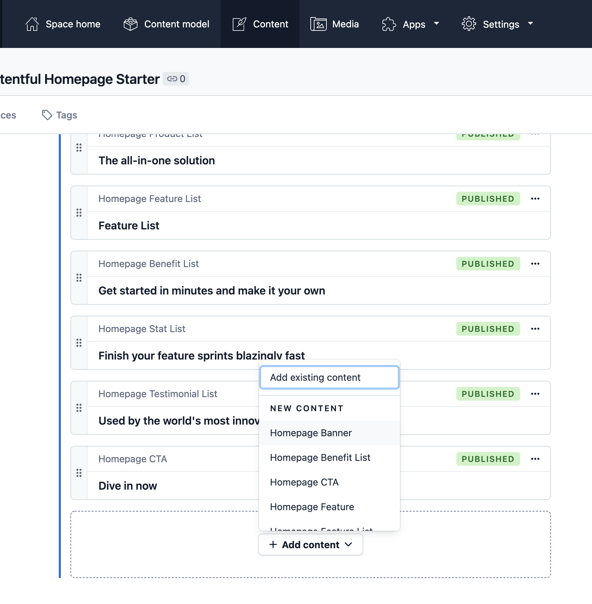

# Gatsby Contentful Homepage

Gatsby 4 homepage starter backed by Contentful, with Vanilla Extract styles.
Based on [gatsbyjs/gatsby-starter-contentful-homepage](https://github.com/gatsbyjs/gatsby-starter-contentful-homepage).

## Setup

Use a Contentful space, its Space ID, a Content Management API key, and a Content
Delivery API key.

```sh
yarn install
yarn setup
yarn start
```

`yarn setup` prompts for Contentful credentials, creates the content model, and
adds demo content. Open `http://localhost:8000` after starting the development
server.

- [Find a Space ID](https://www.contentful.com/help/find-space-id/)
- [Contentful API keys](https://www.contentful.com/developers/docs/references/authentication/)

## Build and Hosting

```sh
yarn build
yarn serve
```

Provide `CONTENTFUL_SPACE_ID` and `CONTENTFUL_ACCESS_TOKEN` to the build
environment; `.env.EXAMPLE` lists the expected keys. Build output is written to
`public/` and can be served by a static host. Contentful setup changes the selected
space's content model and adds demo content.

## Layout

```sh
├── README.md
├── gatsby-config.js
├── gatsby-node.js
├── src
│   ├── components
│   ├── pages
│   ├── colors.css.ts
│   ├── styles.css.ts
│   └── theme.css.ts
└── .env.EXAMPLE
```

1. **`gatsby-config.js`**: [Gatsby config][] file that includes plugins required for this starter.
1. **`gatsby-node.js`**: [Gatsby Node][] config file that creates an abstract data model for the homepage content.
1. **`src/`**: The source directory for the starter, including pages, components, and [Vanilla Extract][] files for styling.

[gatsby config]: https://www.gatsbyjs.com/docs/reference/config-files/gatsby-config/
[gatsby node]: https://www.gatsbyjs.com/docs/reference/config-files/gatsby-node/
[vanilla extract]: https://vanilla-extract.style/

## Customization

### Update the color theme

To update the colors used in this starter, edit the `src/colors.css.ts` file.

```ts
// src/colors.css.ts
export const colors = {
  background: "#ffd500",
  text: "#005bbb",
  primary: "#005bbb",
  muted: "#f5cc00",
  active: "#004287",
  black: "#000",
}

```

If you'd like to add additional colors, add additional keys to this object.
This file is imported into `src/theme.css.ts` and creates CSS custom properties, that can be imported and used in other `.css.ts` files.

The UI components file `src/components/ui.js` imports styles from `src/components/ui.css.ts`. You can see how the theme and color values are being used in this file.

### Add your logo


Replace the `src/components/brand-logo.js` component with your own brand logo.
If you have an SVG version, it can be rendered inline as a React component, following the example in this file. Note that SVG attributes will need to be camel cased for JSX.

Using an inline SVG for the logo allows it to pick up the colors used in CSS, which is how the logo colors are inverted for the mobile menu.

If you prefer to use an image, use the [`StaticImage`](https://www.gatsbyjs.com/docs/reference/built-in-components/gatsby-plugin-image/#staticimage) component from `gatsby-plugin-image` in place of the SVG in this file.

### Customize headings, buttons, and other styles



To further customize the look and feel of the homepage, edit the UI components in `src/components/ui.js` and styles in `src/components/ui.css.ts`.

### Customize section components

To customize any of the sections of the homepage, edit the relevant component in `src/components`.
Most of the styles for these components are handled with shared UI components in `src/components/ui.js`.

### Create custom section components

To create a new type of section in your homepage, you'll want to create a new section component, using the existing components as an example.
For this example, we'll create a new "Banner" component.

1. First, update your content model in Contentful

   1. In your Contentful space, create a new content type and call it "Homepage Banner."

      

   1. For this example, add two fields to your new content type: `heading` and `text` – these can be _Short text_ types.

      
      
      

   1. Find the content type for _Homepage_ in Contentful and edit the settings for the _Content_ field. Under _Validation_, ensure that the new _Homepage Banner_ type is checked to make it available as a content type on the Homepage.

      
      
      

   1. Navigate to the _Content_ tab to edit the _Homepage_ and add a section with this new _Homepage Banner_ content type.

      
      

1. Update `gatsby-node.js`

   Edit your site's `gatsby-node.js` file, adding an interface for `HomepageBanner` that matches your content model in Contentful.
   This allows the homepage to query the abstract `HomepageBanner` type.

   ```js
   // in gatsby-node.js
   exports.createSchemaCustomization = async ({ actions }) => {
     // ...
     actions.createTypes(`
       interface HomepageBanner implements Node & HomepageBlock {
         id: ID!
         blocktype: String
         heading: String
         text: String
       }
     `)
     // ...
     actions.createTypes(`
       type ContentfulHomepageBanner implements Node & HomepageBanner & HomepageBlock @dontInfer {
         id: ID!
         blocktype: String @blocktype
         heading: String
         text: String
       }
     `)
     // ...
   }
   ```

1. Next, create the Banner component:

   ```jsx
   // src/components/banner.js
   import * as React from "react"
   import { graphql } from "gatsby"
   import { Section, Container, Heading, Text } from "./ui"

   export default function Banner(props) {
     return (
       <Section>
         <Container>
           <Heading>{props.heading}</Heading>
           <Text>{props.text}</Text>
         </Container>
       </Section>
     )
   }

   export const query = graphql`
     fragment HomepageBannerContent on HomepageBanner {
       id
       heading
       text
     }
   `
   ```

1. Export the component from `src/components/sections.js`

   ```js
   // src/components/sections.js
   export { default as HomepageHero } from "./hero"
   export { default as HomepageFeature } from "./feature"
   export { default as HomepageFeatureList } from "./feature-list"
   export { default as HomepageLogoList } from "./logo-list"
   export { default as HomepageBenefitList } from "./benefit-list"
   export { default as HomepageTestimonialList } from "./testimonial-list"
   export { default as HomepageStatList } from "./stat-list"
   export { default as HomepageCta } from "./cta"
   export { default as HomepageProductList } from "./product-list"

   // add export for new component
   export { default as HomepageBanner } from "./banner"
   ```

1. Add the GraphQL query fragment to the query in `src/pages/index.js`

   ```js
   // in src/pages/index.js
   export const query = graphql`
     {
       homepage {
         id
         title
         description
         image {
           id
           url
         }
         blocks: content {
           id
           blocktype
           ...HomepageHeroContent
           ...HomepageFeatureContent
           ...HomepageFeatureListContent
           ...HomepageCtaContent
           ...HomepageLogoListContent
           ...HomepageTestimonialListContent
           ...HomepageBenefitListContent
           ...HomepageStatListContent
           ...HomepageProductListContent
           # New component fragment
           ...HomepageBannerContent
         }
       }
     }
   `
   ```

## Troubleshooting

### Errors after making changes to the schema

If you've made changes to the `gatsby-node.js` file or changes to the Contentful data model, clear the Gatsby cache before running the develop server:

```sh
yarn clean && yarn start
```

## References

- [Gatsby documentation](https://www.gatsbyjs.com/docs/)
- [Contentful documentation](https://www.contentful.com/developers/docs/)
- [Adding a blog](docs/adding-a-blog.md)
- License terms: `LICENSE`
